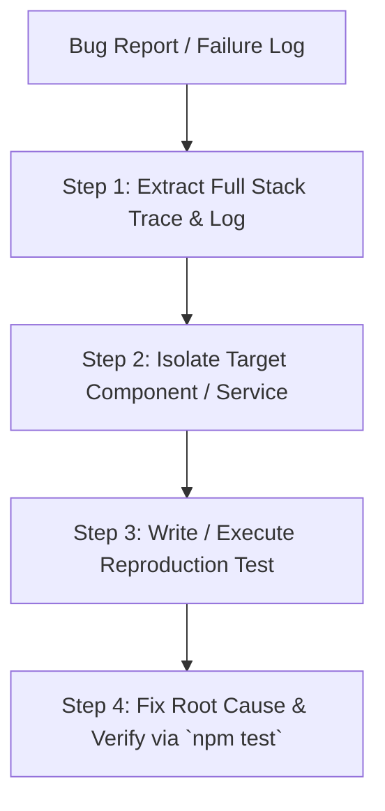

# 🐞 Skill: Systematic Debugging & Bugfix Protocol

## 📌 Skill Overview
Use this skill when encountering bugs, failing Jest test suites, TypeScript type errors, or React Native runtime crashes. This skill strictly prohibits "superficial symptom patching" (such as wrapping errors in silent empty try-catch blocks, suppressing warnings, or returning dummy 0-byte fallbacks).

---

## 📚 0. Industry References & Authoritative Sources
This skill is derived from high-assurance software engineering and agentic debugging protocols:
- **Anthropic / Claude**: *Agentic Systematic Troubleshooting & Log Inspection Protocol* (Empirical root-cause analysis without superficial visual patching).
- **Jest / React Native Testing Library**: *Empirical Test-Driven Bug Reproduction Standard*.

---

## 🔍 1. Primary Investigation Mandate (Empirical Root Cause Analysis)

1. **Inspect Full Stack Traces & Error Logs**: Hypothesizing bug fixes without reading the complete, un-truncated error log output from Jest, Metro Bundler, or Terminal logs is strictly forbidden.
2. **Trace Upstream Data Providers**: If an API returns `undefined` or null, trace data providers upstream inside the Axios Service or React Query Hook rather than merely masking the data bug in the UI layer with optional chaining (`?.`).
3. **Reproduce the Bug**: Write or update a co-located unit test inside `Component.test.tsx` that explicitly reproduces the failing error state before attempting code modifications.

---

## 🛠️ 2. 4-Step Systematic Troubleshooting Protocol

### Step 1: Log Extraction & Analysis
- Execute targeted Jest test runs: `npm test -- -t "test description query"`.
- Pinpoint the exact file path and line number where the error was thrown.

### Step 2: Code Contract Inspection
- Inspect the corresponding TypeScript interfaces. Verify whether component `Props` or `API Response` DTOs align with actual data payloads.
- Audit state mutations: Check if state objects/arrays are being mutated in-place without returning fresh references.

### Step 3: Root Cause Resolution
- **No Visual Patches**: If a button is unclickable, inspect `pointerEvents`, `zIndex`, `onPress` callback bindings, or touch target sizing (44x44 dp) rather than adding arbitrary styling hacks.
- **No Suppressing Warnings**: Using `LogBox.ignoreLogs()` to hide root warnings is strictly prohibited.

### Step 4: Verification Gate
- Execute `npx tsc --noEmit` to ensure TypeScript compilation passes without errors.
- Execute `npm test` to confirm 100% regression suite pass.
